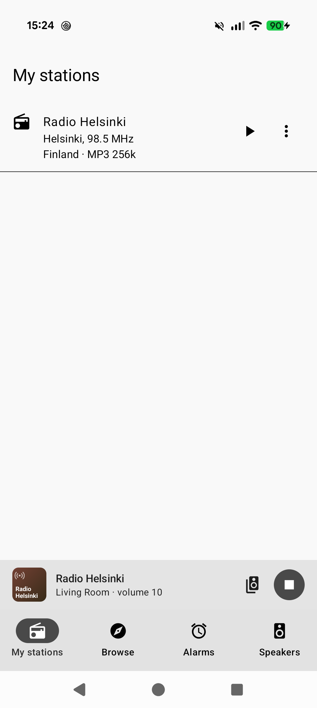

# Longwave

Internet radio and radio alarms for Sonos speakers, without TuneIn.

Longwave tells your Sonos speakers to play a radio station's raw stream URL directly, over the local network. Alarms are saved on the Sonos system itself, so they wake you with the stream whether or not your computer or phone is on. There are no ads and no TuneIn sign-in to expire.

It has two parts: a command-line tool (this folder) and an Android app in [`android/`](android/README.md) with the same features plus station browsing, a control bar, a speaker switcher and a media notification. `soap.sh` is a small curl helper for sending raw Sonos SOAP commands while debugging.



## Setup

The CLI is developed and tested on macOS. It should also work on Linux with any Python 3.

```
git clone https://github.com/gkossinets/longwave.git ~/github/longwave
cd ~/github/longwave
/usr/bin/python3 -m venv .venv && .venv/bin/pip install soco
ln -s ~/github/longwave/longwave ~/bin/longwave    # any folder on your PATH
export LONGWAVE_ROOM=Office                        # optional default room, e.g. in ~/.zshrc
```

- **Why `/usr/bin/python3` on macOS:** the virtualenv is built on Apple's system Python because Homebrew's Python was blocked from the local network. The first time you run `longwave` from Terminal, macOS may ask to allow Terminal on the local network; say yes.
- The `longwave` script runs `longwave.py` with the `.venv` next to it, so it works through a symlink from anywhere.

## Usage

The examples use `helsinki`, the one station `stations.json` ships with (Radio Helsinki). Any internet radio station works; see [Adding stations](#adding-stations).

```
longwave rooms                      # rooms, volume, what's playing
longwave stations                   # configured stations
longwave play helsinki -r Office    # play now (optional -v 15 to set volume)
longwave stop -r Office

longwave alarm list
longwave alarm add 07:00 helsinki -r Office --days weekdays -v 15 --duration 60
longwave alarm add 08:30 helsinki -r Office --days sat,sun
longwave alarm disable <id>
longwave alarm enable <id>
longwave alarm remove <id>
longwave alarm set-station <id> helsinki   # repoint an existing alarm (e.g. an old TuneIn one)
```

- Room names are case-insensitive and are whatever your rooms are called in the Sonos app. Without `LONGWAVE_ROOM`, `-r` is required unless you have only one room.
- `--days` accepts `daily`, `weekdays`, `weekends`, `once`, or a list like `mon,wed,fri`.
- Station names match partially, so `play hel` works.

## Adding stations

Edit `stations.json`; add your own stations or replace the example:

```json
{
  "helsinki": { "name": "Radio Helsinki", "url": "https://stream.radiohelsinki.fi/" },
  "fip":      { "name": "FIP", "url": "https://icecast.radiofrance.fr/fip-hifi.aac" }
}
```

The URL must be the audio stream itself, not the station's web page. Good sources: the station's own "listen" link, or radio-browser.info. MP3 and AAC Shoutcast/Icecast streams work; HLS (`.m3u8`) streams may not.

## How it works

- **Playback:** the stream URL is sent to the room's group coordinator with the `x-rincon-mp3radio://` prefix, which tells Sonos to treat it as an internet radio stream. The CLI drops `https://` (Sonos then fetches over http), which is the path it was tested with. A station that only serves https would need `stream_uri()` changed to keep the scheme. (The Android app keeps the scheme, which also works.)
- **Alarms:** written through the speaker's AlarmClock service (via SoCo), with the stream as the alarm source. If a stream ever fails at alarm time, Sonos falls back to its built-in chime, so you still wake up.

## Caveats

- **Editing an alarm in the Sonos app** may replace the source, since the app can't browse to a raw stream. Manage these alarms with Longwave; enabling or disabling them in the Sonos app should be fine but is untested.
- **The Sonos app may show the alarm source oddly**; the title should read the station's name.
- **Sonos firmware.** This relies on the speakers' local UPnP control, which Sonos still supports on S2 (tested on S2 software 17.2, October 2026). A future firmware update could change that.

## Tested (October 2026, Sonos S2)

- Direct playback of a stream in one room.
- A one-time alarm with the stream as its sound: fired on time and played the stream.
- `alarm add` / `disable` / `remove` round-trip via the CLI.
- Adding rooms to a stream that is already playing, so they play together as a group (Android app: speaker switcher and the system output sheet).
- Switching playback to another room, including away from a stereo pair; the stream carries on in the new room after a second or two (Android app).

## Tests

Unit tests for the CLI's helpers (day parsing, station matching, stream URIs, the wrapper script) need no speaker:

```
.venv/bin/python -m unittest -v
```

## Disclaimer

Longwave is an unofficial, independent project, not affiliated with, endorsed by, or sponsored by Sonos, Inc. "Sonos" is a trademark of Sonos, Inc., used here only to say which speakers this works with. Longwave uses the speakers' local network interface (UPnP), which Sonos does not document for third parties.

## License

[MIT](LICENSE)
